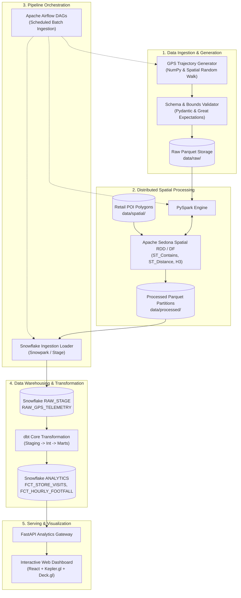

# GeoPulse System Architecture & Data Pipeline Specification

## 1. Executive Summary
**GeoPulse** processes high-volume spatio-temporal mobile device telemetry to deliver actionable hyper-local retail mobility insights. By applying distributed spatial analytics (Apache Sedona) on raw GPS traces, aggregating dwell intervals, and loading analytical models into Snowflake using dbt, GeoPulse provides retail stakeholders with visit frequencies, dwell time distributions, store cannibalization matrices, and catchment boundaries via Kepler.gl and React.

---

## 2. End-to-End Architecture Diagram

---

## 3. Data Flow & Processing Stages

### Stage 1: Telemetry Generation & Validation
- **Input**: Study zone bounding box, retail POI coordinates, device mobility profiles.
- **Processing**:
  - Simulates device movements with realistic velocity limits (pedestrian: 1-5 km/h, vehicle: 15-60 km/h).
  - Injects realistic noise (GPS horizontal dilution of precision, multipath deviations).
  - Validates pings against Pydantic schema: `timestamp_utc`, `latitude`, `longitude`, `speed_mps`, `accuracy`.
- **Output**: Partitioned Parquet files written to `data/raw/date=YYYY-MM-DD/`.

### Stage 2: Spatial Joins & Dwell Time Calculation
- **Input**: Raw GPS coordinates and GeoJSON store polygons.
- **Processing**:
  - Apache Sedona loads store polygons into spatial RDD / DataFrame with spatial indexing (`R-Tree` / `Quadtree`).
  - Spatial point-in-polygon (`ST_Contains(store.geometry, ping.point)`).
  - Dwell interval detection: groups contiguous pings per device within a store polygon; flags a visit if duration > 5 minutes and average speed < 3 km/h.
  - Spatial indexing: attaches Uber H3 index (resolution 8 & 9) for aggregated area footfall.
- **Output**: Processed Parquet files written to `data/processed/store_visits/`.

### Stage 3: Warehouse Ingestion & dbt Modeling
- **Input**: Processed parquet records staged in local storage / cloud bucket.
- **Processing**:
  - Ingested into Snowflake `GEOPULSE_DB.RAW_STAGE.RAW_GPS_TELEMETRY`.
  - **dbt staging**: Casts data types, standardizes timestamps, validates uniqueness.
  - **dbt intermediate**: Computes visit chains (store A -> store B within 2 hours).
  - **dbt marts**: Produces `dim_retail_stores`, `fct_store_visits`, `fct_hourly_footfall`, and `fct_cross_shopping_matrix`.
- **Output**: Snowflake analytical tables ready for BI query consumption.

### Stage 4: Interactive Spatial Dashboard
- **Input**: Aggregated foot-traffic metrics and trajectory GeoJSON via FastAPI.
- **Visualization Components**:
  - **Kepler.gl Map**: Trajectory flow visualization, store polygon heatmaps, H3 hexagonal density layers.
  - **React KPI Dashboard**: Total unique visitors, average dwell duration, hourly rush-hour distribution, competitor overlap matrix.

---

## 4. Security & Privacy Guarantees
- **Data Anonymization**: All simulated device identifiers are hashed (e.g. `DEV_XXXXXXXX`). No personally identifiable information (PII) is created or stored.
- **Credential Isolation**: All Snowflake and API credentials are kept in `.env` files and excluded from git tracking.
